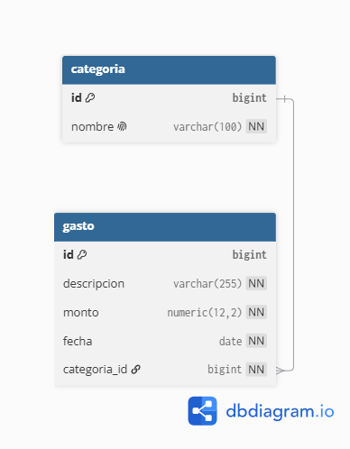

# Control de Gastos

API REST para registrar y categorizar gastos, con un resumen mensual.

## Tecnologías

- Java 21
- Spring Boot
- Maven
- PostgreSQL
- HTML, CSS y JavaScript

## Estado

En desarrollo. Proyecto de práctica.

## Alcance
**La primera versión permite:**
- Crear, listar, editar y borrar gastos.
- Crear y administrar categorías.
- Ver el total del mes y el total por categoría.

**La primera versión NO incluye:**
- Login ni usuarios.
- Múltiples monedas.
- Gráficos.
- Exportar a Excel.

## Modelo de datos

## Autora

Elisa Guaspari